<!-- repo-map:no-verification -->
<!-- GENERATED FILE -- do not edit by hand.
     Regenerate with `repo-tools map`. -->

# neural-computer - Dependency Graph

**Version**: 0.1.0

This document provides a comprehensive dependency graph of all files, components, imports, functions, and variables in the codebase.

---

## Table of Contents

1. [Overview](#overview)
2. [Package Dependencies](#package-dependencies)
3. [App Dependencies](#app-dependencies)
4. [Catalog Dependencies](#catalog-dependencies)
5. [Compute Dependencies](#compute-dependencies)
6. [Root Dependencies](#root-dependencies)
7. [Entry Dependencies](#entry-dependencies)
8. [Memory Dependencies](#memory-dependencies)
9. [Observer Dependencies](#observer-dependencies)
10. [Orchestrator Dependencies](#orchestrator-dependencies)
11. [Renderer Dependencies](#renderer-dependencies)
12. [Runtime Dependencies](#runtime-dependencies)
13. [Types Dependencies](#types-dependencies)
14. [Dependency Matrix](#dependency-matrix)
15. [Circular Dependency Analysis](#circular-dependency-analysis)
16. [Visual Dependency Graph](#visual-dependency-graph)
17. [Summary Statistics](#summary-statistics)

---

<a id="overview"></a>
## Overview

The codebase is organized into the following modules:

- **app**: 2 files
- **catalog**: 5 files
- **compute**: 5 files
- **root**: 3 files
- **entry**: 1 file
- **memory**: 2 files
- **observer**: 3 files
- **orchestrator**: 7 files
- **renderer**: 8 files
- **runtime**: 3 files
- **types**: 2 files

---

<a id="app-dependencies"></a>

## App Dependencies

### `src/app/index.ts` - SPDX-License-Identifier: Apache-2.0

**Internal Dependencies:**
| File | Imports | Type |
|------|---------|------|
| `./nc-app` | `NCApp, NCAppProps` | Re-export |

**Exports:**
- Re-exports: `NCApp`, `NCAppProps`

---

### `src/app/nc-app.tsx` - Props for `NCApp`, the ready-made composition of the runtime, the

**External Dependencies:**
| Package | Import |
|---------|--------|
| `react` | `default` |
| `@json-ui/core` | `UITree` |
| `@json-ui/react` | `ComponentRegistry` |

**Internal Dependencies:**
| File | Imports | Type |
|------|---------|------|
| `../renderer/nc-renderer` | `NCRenderer` | Import |
| `../types` | `AnyCatalog, NCRuntime, NCCatalogVersion, NCIntentHandler` | Import (type-only) |

**Exports:**
- Interfaces: `NCAppProps`
- Functions: `NCApp`

---

<a id="catalog-dependencies"></a>

## Catalog Dependencies

### `src/catalog/durable-path.ts` - Durable-store paths are `/`-separated. Empty paths are a no-op in

**Internal Dependencies:**
| File | Imports | Type |
|------|---------|------|
| `./limits` | `NC_DURABLE_PATH_MAX_LENGTH, NC_DURABLE_PATH_MAX_SEGMENTS, NC_RESERVED_FIELD_IDS` | Import |

**Exports:**
- Functions: `isSafeDurablePath`

---

### `src/catalog/field-id.ts` - Field IDs key the staging buffer. They must be non-empty, not a

**External Dependencies:**
| Package | Import |
|---------|--------|
| `zod` | `z` |

**Internal Dependencies:**
| File | Imports | Type |
|------|---------|------|
| `./limits` | `NC_FIELD_ID_MAX_LENGTH, NC_RESERVED_FIELD_IDS` | Import |

**Exports:**
- Functions: `isSafeFieldId`
- Constants: `ncFieldIdSchema`

---

### `src/catalog/index.ts` - SPDX-License-Identifier: Apache-2.0

**Internal Dependencies:**
| File | Imports | Type |
|------|---------|------|
| `./nc-catalog` | `ncStarterCatalog, NC_CATALOG_VERSION, NC_LLM_ACCEPTANCE_CONTRACT` | Re-export |
| `./field-id` | `ncFieldIdSchema, isSafeFieldId` | Re-export |
| `./durable-path` | `isSafeDurablePath` | Re-export |
| `./limits` | `NC_FIELD_ID_MAX_LENGTH, NC_STRING_MAX_LENGTH, NC_ACTION_PARAM_MAX_KEYS, NC_STAGING_MAX_FIELDS, NC_SNAPSHOT_MAX_BYTES, NC_SELECT_MAX_OPTIONS, NC_DURABLE_PATH_MAX_LENGTH, NC_DURABLE_PATH_MAX_SEGMENTS, NC_DURABLE_VALUE_MAX_BYTES, NC_OBSERVER_STALE_THRESHOLD, NC_STARTER_ACTIONS, NC_RESERVED_FIELD_IDS, NCStarterActionName` | Re-export |

**Exports:**
- Re-exports:

  ```text
  ncStarterCatalog, NC_CATALOG_VERSION, NC_LLM_ACCEPTANCE_CONTRACT, ncFieldIdSchema, isSafeFieldId,
  isSafeDurablePath, NC_FIELD_ID_MAX_LENGTH, NC_STRING_MAX_LENGTH, NC_ACTION_PARAM_MAX_KEYS,
  NC_STAGING_MAX_FIELDS, NC_SNAPSHOT_MAX_BYTES, NC_SELECT_MAX_OPTIONS, NC_DURABLE_PATH_MAX_LENGTH,
  NC_DURABLE_PATH_MAX_SEGMENTS, NC_DURABLE_VALUE_MAX_BYTES, NC_OBSERVER_STALE_THRESHOLD,
  NC_STARTER_ACTIONS, NC_RESERVED_FIELD_IDS, NCStarterActionName
  ```


---

### `src/catalog/limits.ts` - Caps for catalog strings and staging-bound input. Unbounded LLM-emitted

**Exports:**
- Types: `NCStarterActionName`
- Constants:

  ```text
  NC_FIELD_ID_MAX_LENGTH, NC_STRING_MAX_LENGTH, NC_ACTION_PARAM_MAX_KEYS, NC_STAGING_MAX_FIELDS,
  NC_SNAPSHOT_MAX_BYTES, NC_SELECT_MAX_OPTIONS, NC_DURABLE_PATH_MAX_LENGTH,
  NC_DURABLE_PATH_MAX_SEGMENTS, NC_DURABLE_VALUE_MAX_BYTES, NC_OBSERVER_STALE_THRESHOLD,
  NC_STARTER_ACTIONS, NC_RESERVED_FIELD_IDS
  ```


---

### `src/catalog/nc-catalog.ts` - Version string threaded through every emitted IntentEvent.catalog_version

**External Dependencies:**
| Package | Import |
|---------|--------|
| `@json-ui/core` | `createCatalog` |
| `zod` | `z` |

**Internal Dependencies:**
| File | Imports | Type |
|------|---------|------|
| `../types` | `asNCCatalogVersion` | Import |
| `./field-id` | `ncFieldIdSchema` | Import |
| `./limits` | `NC_ACTION_PARAM_MAX_KEYS, NC_RESERVED_FIELD_IDS, NC_SELECT_MAX_OPTIONS, NC_STRING_MAX_LENGTH, NC_STARTER_ACTIONS` | Import |

**Exports:**
- Constants: `NC_CATALOG_VERSION`, `NC_LLM_ACCEPTANCE_CONTRACT`, `ncStarterCatalog`

---

<a id="compute-dependencies"></a>

## Compute Dependencies

### `src/compute/index.ts` - SPDX-License-Identifier: Apache-2.0

**Internal Dependencies:**
| File | Imports | Type |
|------|---------|------|
| `./limits` | `NC_REPL_CONTEXT_NAME, NC_REPL_DEFAULT_PYTHON, NC_REPL_DEFAULT_TIMEOUT_MS, NC_REPL_MAX_CODE_BYTES, NC_REPL_MAX_IDENT_LENGTH, NC_REPL_MAX_STDOUT_BYTES, NC_REPL_MAX_VALUE_BYTES, NC_REPL_MAX_LLM_PROMPT_BYTES, NC_REPL_MAX_LLM_REPLY_BYTES, NC_REPL_PROTOCOL_VERSION` | Re-export |
| `./types` | `NCReplError, NCReplErrorCode` | Re-export |
| `./types` | `CreatePythonReplOptions, NCPythonRepl, NCReplExecResult` | Re-export (type-only) |
| `./python-repl` | `createPythonRepl, createWorkerSpawnOptions` | Re-export |
| `./worker-path` | `resolveWorkerPath` | Re-export |

**Exports:**
- Re-exports:

  ```text
  NC_REPL_CONTEXT_NAME, NC_REPL_DEFAULT_PYTHON, NC_REPL_DEFAULT_TIMEOUT_MS, NC_REPL_MAX_CODE_BYTES,
  NC_REPL_MAX_IDENT_LENGTH, NC_REPL_MAX_STDOUT_BYTES, NC_REPL_MAX_VALUE_BYTES,
  NC_REPL_MAX_LLM_PROMPT_BYTES, NC_REPL_MAX_LLM_REPLY_BYTES, NC_REPL_PROTOCOL_VERSION, NCReplError,
  NCReplErrorCode, CreatePythonReplOptions, NCPythonRepl, NCReplExecResult, createPythonRepl,
  createWorkerSpawnOptions, resolveWorkerPath
  ```


---

### `src/compute/limits.ts` - Caps for the Python REPL worker. Unbounded snippets and prints would

**Exports:**
- Constants:

  ```text
  NC_REPL_DEFAULT_TIMEOUT_MS, NC_REPL_MAX_CODE_BYTES, NC_REPL_MAX_STDOUT_BYTES,
  NC_REPL_MAX_VALUE_BYTES, NC_REPL_MAX_IDENT_LENGTH, NC_REPL_MAX_LLM_PROMPT_BYTES,
  NC_REPL_MAX_LLM_REPLY_BYTES, NC_REPL_PROTOCOL_VERSION, NC_REPL_CONTEXT_NAME, NC_REPL_DEFAULT_PYTHON
  ```


---

### `src/compute/python-repl.ts` - Minimal env + cwd for the worker. The child must not inherit host

**Node.js Built-in Dependencies:**
| Module | Import |
|--------|--------|
| `child_process` | `spawn, ChildProcess` |
| `crypto` | `randomUUID` |
| `os` | `tmpdir` |

**Internal Dependencies:**
| File | Imports | Type |
|------|---------|------|
| `./limits` | `NC_REPL_CONTEXT_NAME, NC_REPL_DEFAULT_PYTHON, NC_REPL_DEFAULT_TIMEOUT_MS, NC_REPL_MAX_CODE_BYTES, NC_REPL_MAX_IDENT_LENGTH, NC_REPL_MAX_LLM_PROMPT_BYTES, NC_REPL_MAX_LLM_REPLY_BYTES, NC_REPL_MAX_STDOUT_BYTES, NC_REPL_MAX_VALUE_BYTES, NC_REPL_PROTOCOL_VERSION` | Import |
| `./types` | `NCReplError, CreatePythonReplOptions, NCPythonRepl, NCReplExecResult` | Import |
| `./worker-path` | `resolveWorkerPath` | Import |

**Exports:**
- Classes: `PythonRepl`
- Functions: `createWorkerSpawnOptions`, `createPythonRepl`

---

### `src/compute/types.ts` - Why one REPL operation failed. `busy` means a second call arrived

**Exports:**
- Classes: `NCReplError`
- Interfaces: `CreatePythonReplOptions`, `NCReplExecResult`, `NCPythonRepl`
- Types: `NCReplErrorCode`

---

### `src/compute/worker-path.ts` - Locate worker.py next to this module (source tree) or next to the

**Node.js Built-in Dependencies:**
| Module | Import |
|--------|--------|
| `fs` | `existsSync` |
| `path` | `dirname, join` |
| `url` | `fileURLToPath` |

**Internal Dependencies:**
| File | Imports | Type |
|------|---------|------|
| `./types` | `NCReplError` | Import |

**Exports:**
- Functions: `resolveWorkerPath`

---

<a id="root-dependencies"></a>

## Root Dependencies

### `src/core.ts` - React-free entry for Node / orchestrator processes.

**Internal Dependencies:**
| File | Imports | Type |
|------|---------|------|
| `./catalog` | `ncStarterCatalog, NC_CATALOG_VERSION, NC_LLM_ACCEPTANCE_CONTRACT, ncFieldIdSchema, isSafeFieldId, isSafeDurablePath, NC_FIELD_ID_MAX_LENGTH, NC_STRING_MAX_LENGTH, NC_STAGING_MAX_FIELDS, NC_SNAPSHOT_MAX_BYTES, NC_STARTER_ACTIONS` | Re-export |
| `./types` | `NCIntentHandler, NCCatalogVersion, NCObserver, NCRuntime, AnyCatalog` | Re-export (type-only) |
| `./types` | `asNCCatalogVersion, isNCCatalogVersion` | Re-export |
| `./runtime` | `createNCRuntime, CreateNCRuntimeOptions` | Re-export |
| `./memory` | `defaultNCProjection, NCProjectedData, NCProjectedEntity, NCProjectedRelation` | Re-export |
| `./orchestrator` | `createStubIntentHandler, submittedFieldsStillPresent, CreateStubIntentHandlerOptions, createLlmIntentHandler, composeNcObservation, createAnthropicTransport, createAnthropicIntentHandler, NCLlmError, NC_OBSERVATION_MAX_BYTES, NC_LLM_DEFAULT_MAX_ROUNDS, NC_LLM_MAX_ROUNDS, NC_LLM_DEFAULT_MAX_TOKENS, NC_DEFAULT_ANTHROPIC_MODEL, CreateLlmIntentHandlerOptions, DurableWrite, NCLlmTransport, NCLlmMessage, NCLlmContent, NCLlmTool, CreateAnthropicTransportOptions, NCLlmErrorCode` | Re-export |
| `./observer` | `createNCObserver, ncHeadlessRegistry, CreateNCObserverOptions` | Re-export |
| `./compute` | `createPythonRepl, resolveWorkerPath, NCReplError, NC_REPL_CONTEXT_NAME, NC_REPL_DEFAULT_PYTHON, NC_REPL_DEFAULT_TIMEOUT_MS, NC_REPL_MAX_CODE_BYTES, NC_REPL_MAX_IDENT_LENGTH, NC_REPL_MAX_STDOUT_BYTES, NC_REPL_MAX_VALUE_BYTES, NC_REPL_MAX_LLM_PROMPT_BYTES, NC_REPL_MAX_LLM_REPLY_BYTES, NC_REPL_PROTOCOL_VERSION, CreatePythonReplOptions, NCPythonRepl, NCReplExecResult, NCReplErrorCode` | Re-export |

**Exports:**
- Re-exports:

  ```text
  ncStarterCatalog, NC_CATALOG_VERSION, NC_LLM_ACCEPTANCE_CONTRACT, ncFieldIdSchema, isSafeFieldId,
  isSafeDurablePath, NC_FIELD_ID_MAX_LENGTH, NC_STRING_MAX_LENGTH, NC_STAGING_MAX_FIELDS,
  NC_SNAPSHOT_MAX_BYTES, NC_STARTER_ACTIONS, NCIntentHandler, NCCatalogVersion, NCObserver, NCRuntime,
  AnyCatalog, asNCCatalogVersion, isNCCatalogVersion, createNCRuntime, CreateNCRuntimeOptions,
  defaultNCProjection, NCProjectedData, NCProjectedEntity, NCProjectedRelation,
  createStubIntentHandler, submittedFieldsStillPresent, CreateStubIntentHandlerOptions,
  createLlmIntentHandler, composeNcObservation, createAnthropicTransport,
  createAnthropicIntentHandler, NCLlmError, NC_OBSERVATION_MAX_BYTES, NC_LLM_DEFAULT_MAX_ROUNDS,
  NC_LLM_MAX_ROUNDS, NC_LLM_DEFAULT_MAX_TOKENS, NC_DEFAULT_ANTHROPIC_MODEL,
  CreateLlmIntentHandlerOptions, DurableWrite, NCLlmTransport, NCLlmMessage, NCLlmContent, NCLlmTool,
  CreateAnthropicTransportOptions, NCLlmErrorCode, createNCObserver, ncHeadlessRegistry,
  CreateNCObserverOptions, createPythonRepl, resolveWorkerPath, NCReplError, NC_REPL_CONTEXT_NAME,
  NC_REPL_DEFAULT_PYTHON, NC_REPL_DEFAULT_TIMEOUT_MS, NC_REPL_MAX_CODE_BYTES,
  NC_REPL_MAX_IDENT_LENGTH, NC_REPL_MAX_STDOUT_BYTES, NC_REPL_MAX_VALUE_BYTES,
  NC_REPL_MAX_LLM_PROMPT_BYTES, NC_REPL_MAX_LLM_REPLY_BYTES, NC_REPL_PROTOCOL_VERSION,
  CreatePythonReplOptions, NCPythonRepl, NCReplExecResult, NCReplErrorCode
  ```


---

### `src/react.ts` - SPDX-License-Identifier: Apache-2.0

**Internal Dependencies:**
| File | Imports | Type |
|------|---------|------|
| `./renderer` | `NCRenderer, NCContainer, NCText, NCTextField, NCCheckbox, NCSelect, NCButton, useCommittedTree, NCErrorBoundary, NCRendererProps, NCComponentProps, UseCommittedTreeOptions` | Re-export |
| `./app` | `NCApp, NCAppProps` | Re-export |

**Exports:**
- Re-exports:

  ```text
  NCRenderer, NCContainer, NCText, NCTextField, NCCheckbox, NCSelect, NCButton, useCommittedTree,
  NCErrorBoundary, NCRendererProps, NCComponentProps, UseCommittedTreeOptions, NCApp, NCAppProps
  ```


---

### `src/test-setup.ts` - SPDX-License-Identifier: Apache-2.0

**External Dependencies:**
| Package | Import |
|---------|--------|
| `vitest` | `afterEach` |
| `@testing-library/react` | `cleanup` |

---

<a id="entry-dependencies"></a>

## Entry Dependencies

### `src/index.ts` - Neural Computer — public entry point.

**Internal Dependencies:**
| File | Imports | Type |
|------|---------|------|
| `./catalog` | `ncStarterCatalog, NC_CATALOG_VERSION, NC_LLM_ACCEPTANCE_CONTRACT, ncFieldIdSchema, isSafeFieldId, isSafeDurablePath, NC_FIELD_ID_MAX_LENGTH, NC_STRING_MAX_LENGTH, NC_STAGING_MAX_FIELDS, NC_SNAPSHOT_MAX_BYTES, NC_STARTER_ACTIONS` | Re-export |
| `./types` | `NCIntentHandler, NCCatalogVersion, NCObserver, NCRuntime, AnyCatalog` | Re-export (type-only) |
| `./types` | `asNCCatalogVersion, isNCCatalogVersion` | Re-export |
| `./runtime` | `createNCRuntime, CreateNCRuntimeOptions` | Re-export |
| `./memory` | `defaultNCProjection, NCProjectedData, NCProjectedEntity, NCProjectedRelation` | Re-export |
| `./renderer` | `NCRenderer, NCContainer, NCText, NCTextField, NCCheckbox, NCSelect, NCButton, useCommittedTree, NCErrorBoundary, NCRendererProps, NCComponentProps, UseCommittedTreeOptions` | Re-export |
| `./orchestrator` | `createStubIntentHandler, submittedFieldsStillPresent, CreateStubIntentHandlerOptions, createLlmIntentHandler, composeNcObservation, createAnthropicTransport, createAnthropicIntentHandler, NCLlmError, NC_OBSERVATION_MAX_BYTES, NC_LLM_DEFAULT_MAX_ROUNDS, NC_LLM_MAX_ROUNDS, NC_LLM_DEFAULT_MAX_TOKENS, NC_DEFAULT_ANTHROPIC_MODEL, CreateLlmIntentHandlerOptions, DurableWrite, NCLlmTransport, NCLlmMessage, NCLlmContent, NCLlmTool, CreateAnthropicTransportOptions, NCLlmErrorCode` | Re-export |
| `./app` | `NCApp, NCAppProps` | Re-export |
| `./observer` | `createNCObserver, ncHeadlessRegistry, CreateNCObserverOptions` | Re-export |
| `./compute` | `createPythonRepl, resolveWorkerPath, NCReplError, NC_REPL_CONTEXT_NAME, NC_REPL_DEFAULT_PYTHON, NC_REPL_DEFAULT_TIMEOUT_MS, NC_REPL_MAX_CODE_BYTES, NC_REPL_MAX_IDENT_LENGTH, NC_REPL_MAX_STDOUT_BYTES, NC_REPL_MAX_VALUE_BYTES, NC_REPL_MAX_LLM_PROMPT_BYTES, NC_REPL_MAX_LLM_REPLY_BYTES, NC_REPL_PROTOCOL_VERSION, CreatePythonReplOptions, NCPythonRepl, NCReplExecResult, NCReplErrorCode` | Re-export |

**Exports:**
- Re-exports:

  ```text
  ncStarterCatalog, NC_CATALOG_VERSION, NC_LLM_ACCEPTANCE_CONTRACT, ncFieldIdSchema, isSafeFieldId,
  isSafeDurablePath, NC_FIELD_ID_MAX_LENGTH, NC_STRING_MAX_LENGTH, NC_STAGING_MAX_FIELDS,
  NC_SNAPSHOT_MAX_BYTES, NC_STARTER_ACTIONS, NCIntentHandler, NCCatalogVersion, NCObserver, NCRuntime,
  AnyCatalog, asNCCatalogVersion, isNCCatalogVersion, createNCRuntime, CreateNCRuntimeOptions,
  defaultNCProjection, NCProjectedData, NCProjectedEntity, NCProjectedRelation, NCRenderer,
  NCContainer, NCText, NCTextField, NCCheckbox, NCSelect, NCButton, useCommittedTree, NCErrorBoundary,
  NCRendererProps, NCComponentProps, UseCommittedTreeOptions, createStubIntentHandler,
  submittedFieldsStillPresent, CreateStubIntentHandlerOptions, createLlmIntentHandler,
  composeNcObservation, createAnthropicTransport, createAnthropicIntentHandler, NCLlmError,
  NC_OBSERVATION_MAX_BYTES, NC_LLM_DEFAULT_MAX_ROUNDS, NC_LLM_MAX_ROUNDS, NC_LLM_DEFAULT_MAX_TOKENS,
  NC_DEFAULT_ANTHROPIC_MODEL, CreateLlmIntentHandlerOptions, DurableWrite, NCLlmTransport,
  NCLlmMessage, NCLlmContent, NCLlmTool, CreateAnthropicTransportOptions, NCLlmErrorCode, NCApp,
  NCAppProps, createNCObserver, ncHeadlessRegistry, CreateNCObserverOptions, createPythonRepl,
  resolveWorkerPath, NCReplError, NC_REPL_CONTEXT_NAME, NC_REPL_DEFAULT_PYTHON,
  NC_REPL_DEFAULT_TIMEOUT_MS, NC_REPL_MAX_CODE_BYTES, NC_REPL_MAX_IDENT_LENGTH,
  NC_REPL_MAX_STDOUT_BYTES, NC_REPL_MAX_VALUE_BYTES, NC_REPL_MAX_LLM_PROMPT_BYTES,
  NC_REPL_MAX_LLM_REPLY_BYTES, NC_REPL_PROTOCOL_VERSION, CreatePythonReplOptions, NCPythonRepl,
  NCReplExecResult, NCReplErrorCode
  ```


---

<a id="memory-dependencies"></a>

## Memory Dependencies

### `src/memory/index.ts` - SPDX-License-Identifier: Apache-2.0

**Internal Dependencies:**
| File | Imports | Type |
|------|---------|------|
| `./projection` | `defaultNCProjection, NCProjectedData, NCProjectedEntity, NCProjectedRelation` | Re-export |

**Exports:**
- Re-exports: `defaultNCProjection`, `NCProjectedData`, `NCProjectedEntity`, `NCProjectedRelation`

---

### `src/memory/projection.ts` - The flat view NC exposes to @json-ui/react's DataProvider via the

**External Dependencies:**
| Package | Import |
|---------|--------|
| `@danielsimonjr/memoryjs` | `Entity, Relation, GraphProjection, JSONValue` |

**Internal Dependencies:**
| File | Imports | Type |
|------|---------|------|
| `../runtime/freeze` | `dict` | Import |

**Exports:**
- Interfaces: `NCProjectedRelation`, `NCProjectedData`, `NCProjectedEntity`
- Constants: `defaultNCProjection`

---

<a id="observer-dependencies"></a>

## Observer Dependencies

### `src/observer/index.ts` - SPDX-License-Identifier: Apache-2.0

**Internal Dependencies:**
| File | Imports | Type |
|------|---------|------|
| `./nc-observer` | `createNCObserver, CreateNCObserverOptions` | Re-export |
| `./nc-headless-components` | `ncHeadlessRegistry` | Re-export |

**Exports:**
- Re-exports: `createNCObserver`, `CreateNCObserverOptions`, `ncHeadlessRegistry`

---

### `src/observer/nc-headless-components.ts` - Six headless components mirroring NC's React input-components surface.

**External Dependencies:**
| Package | Import |
|---------|--------|
| `@json-ui/headless` | `HeadlessComponent, HeadlessRegistry` |
| `@json-ui/core` | `JSONValue, UIElement` |

**Exports:**
- Constants: `ncHeadlessRegistry`

---

### `src/observer/nc-observer.ts` - Options for {@link createNCObserver}. The catalog binds once, at

**External Dependencies:**
| Package | Import |
|---------|--------|
| `@json-ui/headless` | `createHeadlessRenderer, JsonStringSerializer, createHtmlSerializer, HeadlessRegistry, NormalizedNode` |
| `@json-ui/core` | `ObservableDataModel, StagingBuffer, UITree` |

**Internal Dependencies:**
| File | Imports | Type |
|------|---------|------|
| `./nc-headless-components` | `ncHeadlessRegistry` | Import |
| `../catalog/limits` | `NC_OBSERVER_STALE_THRESHOLD` | Import |
| `../runtime/freeze` | `freezeDeep` | Import |
| `../types` | `AnyCatalog, NCObserver` | Import (type-only) |

**Exports:**
- Interfaces: `CreateNCObserverOptions`
- Functions: `createNCObserver`

---

<a id="orchestrator-dependencies"></a>

## Orchestrator Dependencies

### `src/orchestrator/anthropic-transport.ts` - Options for {@link createAnthropicTransport}. `model` and

**External Dependencies:**
| Package | Import |
|---------|--------|
| `@anthropic-ai/sdk` | `default` |

**Internal Dependencies:**
| File | Imports | Type |
|------|---------|------|
| `./limits` | `NC_DEFAULT_ANTHROPIC_MODEL, NC_LLM_DEFAULT_MAX_TOKENS` | Import |
| `./llm-transport` | `NCLlmCompleteRequest, NCLlmContent, NCLlmToolResultContent, NCLlmToolUseContent, NCLlmTransport` | Import (type-only) |
| `./llm-handler` | `createLlmIntentHandler, CreateLlmIntentHandlerOptions` | Import |
| `../types` | `NCIntentHandler` | Import (type-only) |

**Exports:**
- Interfaces: `CreateAnthropicTransportOptions`
- Functions: `createAnthropicTransport`, `createAnthropicIntentHandler`

---

### `src/orchestrator/handle-intent.ts` - Options for the stub intent handler. The stub is deterministic —

**External Dependencies:**
| Package | Import |
|---------|--------|
| `@json-ui/core` | `collectFieldIds, IntentEvent, UITree` |

**Internal Dependencies:**
| File | Imports | Type |
|------|---------|------|
| `../types` | `AnyCatalog, NCIntentHandler` | Import (type-only) |

**Exports:**
- Interfaces: `CreateStubIntentHandlerOptions`
- Functions: `createStubIntentHandler`, `submittedFieldsStillPresent`

---

### `src/orchestrator/index.ts` - SPDX-License-Identifier: Apache-2.0

**Internal Dependencies:**
| File | Imports | Type |
|------|---------|------|
| `./handle-intent` | `createStubIntentHandler, submittedFieldsStillPresent, CreateStubIntentHandlerOptions` | Re-export |
| `./observation` | `composeNcObservation, ComposeNcObservationInput, NcObservation` | Re-export |
| `./llm-handler` | `createLlmIntentHandler, CreateLlmIntentHandlerOptions, DurableWrite` | Re-export |
| `./llm-transport` | `NCLlmError, NCLlmErrorCode, NCLlmTransport, NCLlmMessage, NCLlmContent, NCLlmTool, NCLlmCompleteRequest, NCLlmCompleteResponse` | Re-export |
| `./anthropic-transport` | `createAnthropicTransport, createAnthropicIntentHandler, CreateAnthropicTransportOptions` | Re-export |
| `./limits` | `NC_OBSERVATION_MAX_BYTES, NC_LLM_DEFAULT_MAX_ROUNDS, NC_LLM_MAX_ROUNDS, NC_LLM_MAX_TOOLS_PER_ROUND, NC_LLM_MAX_TOOL_RESULT_BYTES, NC_LLM_DEFAULT_MAX_TOKENS, NC_DEFAULT_ANTHROPIC_MODEL` | Re-export |

**Exports:**
- Re-exports:

  ```text
  createStubIntentHandler, submittedFieldsStillPresent, CreateStubIntentHandlerOptions,
  composeNcObservation, ComposeNcObservationInput, NcObservation, createLlmIntentHandler,
  CreateLlmIntentHandlerOptions, DurableWrite, NCLlmError, NCLlmErrorCode, NCLlmTransport,
  NCLlmMessage, NCLlmContent, NCLlmTool, NCLlmCompleteRequest, NCLlmCompleteResponse,
  createAnthropicTransport, createAnthropicIntentHandler, CreateAnthropicTransportOptions,
  NC_OBSERVATION_MAX_BYTES, NC_LLM_DEFAULT_MAX_ROUNDS, NC_LLM_MAX_ROUNDS, NC_LLM_MAX_TOOLS_PER_ROUND,
  NC_LLM_MAX_TOOL_RESULT_BYTES, NC_LLM_DEFAULT_MAX_TOKENS, NC_DEFAULT_ANTHROPIC_MODEL
  ```


---

### `src/orchestrator/limits.ts` - SPDX-License-Identifier: Apache-2.0

**Exports:**
- Constants: `NC_OBSERVATION_MAX_BYTES`, `NC_LLM_DEFAULT_MAX_ROUNDS`, `NC_LLM_MAX_ROUNDS`, `NC_LLM_MAX_TOOLS_PER_ROUND`, `NC_LLM_MAX_TOOL_RESULT_BYTES`, `NC_LLM_DEFAULT_MAX_TOKENS`, `NC_DEFAULT_ANTHROPIC_MODEL`

---

### `src/orchestrator/llm-handler.ts` - One `durable_write` request from the model. `path` is a `/`-separated

**External Dependencies:**
| Package | Import |
|---------|--------|
| `@json-ui/core` | `generateCatalogPrompt, validateJSONValue, JSONValue, UITree` |

**Internal Dependencies:**
| File | Imports | Type |
|------|---------|------|
| `../catalog` | `isSafeDurablePath, NC_DURABLE_VALUE_MAX_BYTES, NC_LLM_ACCEPTANCE_CONTRACT` | Import |
| `../compute` | `NCPythonRepl` | Import (type-only) |
| `../types` | `AnyCatalog, NCIntentHandler, NCRuntime` | Import (type-only) |
| `./limits` | `NC_LLM_DEFAULT_MAX_ROUNDS, NC_LLM_MAX_ROUNDS, NC_LLM_MAX_TOOL_RESULT_BYTES, NC_LLM_MAX_TOOLS_PER_ROUND` | Import |
| `./llm-transport` | `NCLlmError, NCLlmContent, NCLlmMessage, NCLlmTool, NCLlmToolUseContent, NCLlmTransport` | Import |
| `./observation` | `composeNcObservation` | Import |

**Exports:**
- Interfaces: `DurableWrite`, `CreateLlmIntentHandlerOptions`
- Functions: `createLlmIntentHandler`

---

### `src/orchestrator/llm-transport.ts` - A model request to call one tool. `id` correlates the call with the

**Exports:**
- Classes: `NCLlmError`
- Interfaces: `NCLlmMessage`, `NCLlmTool`, `NCLlmCompleteRequest`, `NCLlmCompleteResponse`, `NCLlmTransport`
- Types: `NCLlmRole`, `NCLlmTextContent`, `NCLlmToolUseContent`, `NCLlmToolResultContent`, `NCLlmContent`, `NCLlmErrorCode`

---

### `src/orchestrator/observation.ts` - Input for {@link composeNcObservation}. `maxBytes` defaults to

**External Dependencies:**
| Package | Import |
|---------|--------|
| `@json-ui/core` | `IntentEvent` |

**Internal Dependencies:**
| File | Imports | Type |
|------|---------|------|
| `./limits` | `NC_OBSERVATION_MAX_BYTES` | Import |

**Exports:**
- Interfaces: `ComposeNcObservationInput`, `NcObservation`
- Functions: `composeNcObservation`

---

<a id="renderer-dependencies"></a>

## Renderer Dependencies

### `src/renderer/error-boundary.tsx` - Catches render throws from NC components so a single bad cast cannot

**External Dependencies:**
| Package | Import |
|---------|--------|
| `react` | `default` |

**Exports:**
- Classes: `NCErrorBoundary`

---

### `src/renderer/field-id-stability.ts` - Map every input field id in `tree` to its component type. Only

**External Dependencies:**
| Package | Import |
|---------|--------|
| `@json-ui/core` | `UITree` |

**Exports:**
- Classes: `FieldIdTypeChangeError`
- Functions: `collectFieldIdTypes`, `detectFieldIdTypeChanges`, `commitFieldIdTypes`

---

### `src/renderer/index.ts` - SPDX-License-Identifier: Apache-2.0

**Internal Dependencies:**
| File | Imports | Type |
|------|---------|------|
| `./input-components` | `NCContainer, NCText, NCTextField, NCCheckbox, NCSelect, NCButton, NCComponentProps` | Re-export |
| `./nc-renderer` | `NCRenderer, NCRendererProps` | Re-export |
| `./use-committed-tree` | `useCommittedTree, UseCommittedTreeOptions` | Re-export |
| `./error-boundary` | `NCErrorBoundary` | Re-export |
| `./field-id-stability` | `collectFieldIdTypes, detectFieldIdTypeChanges, FieldIdTypeChangeError` | Re-export |

**Exports:**
- Re-exports:

  ```text
  NCContainer, NCText, NCTextField, NCCheckbox, NCSelect, NCButton, NCComponentProps, NCRenderer,
  NCRendererProps, useCommittedTree, UseCommittedTreeOptions, NCErrorBoundary, collectFieldIdTypes,
  detectFieldIdTypeChanges, FieldIdTypeChangeError
  ```


---

### `src/renderer/input-components.tsx` - Props shape used by all NC-authored React components. Matches the

**External Dependencies:**
| Package | Import |
|---------|--------|
| `react` | `default` |
| `@json-ui/react` | `useStagingField, useActions` |
| `@json-ui/core` | `UIElement` |

**Internal Dependencies:**
| File | Imports | Type |
|------|---------|------|
| `../catalog/limits` | `NC_STRING_MAX_LENGTH` | Import |
| `./intent-flight-context` | `FocusFieldContext, IntentFlightContext` | Import |

**Exports:**
- Interfaces: `NCComponentProps`
- Constants: `NCContainer`, `NCText`, `NCTextField`, `NCCheckbox`, `NCSelect`, `NCButton`

---

### `src/renderer/intent-flight-context.ts` - True while createNCRuntime is awaiting a handler. NCButton reads this

**External Dependencies:**
| Package | Import |
|---------|--------|
| `react` | `default` |

**Exports:**
- Constants: `IntentFlightContext`, `FocusFieldContext`

---

### `src/renderer/nc-renderer.tsx` - The committed tree to render. Must come from a successful stream

**External Dependencies:**
| Package | Import |
|---------|--------|
| `react` | `default` |
| `@json-ui/react` | `JSONUIProvider, Renderer, ComponentRegistry` |
| `@json-ui/core` | `collectFieldIds, IntentEvent, UITree` |

**Internal Dependencies:**
| File | Imports | Type |
|------|---------|------|
| `./input-components` | `NCContainer, NCText, NCTextField, NCCheckbox, NCSelect, NCButton` | Import |
| `../types` | `AnyCatalog, NCRuntime, NCCatalogVersion` | Import (type-only) |
| `./error-boundary` | `NCErrorBoundary` | Import |
| `./intent-flight-context` | `FocusFieldContext, IntentFlightContext` | Import |
| `./field-id-stability` | `collectFieldIdTypes, commitFieldIdTypes, detectFieldIdTypeChanges` | Import |
| `./read-only-store` | `readOnlyDurableStore` | Import |

**Exports:**
- Interfaces: `NCRendererProps`
- Functions: `NCRenderer`

---

### `src/renderer/read-only-store.ts` - React DataProvider must not mutate durable state. Built-in NC inputs

**External Dependencies:**
| Package | Import |
|---------|--------|
| `@json-ui/core` | `JSONValue, ObservableDataModel` |

**Exports:**
- Functions: `readOnlyDurableStore`

---

### `src/renderer/use-committed-tree.ts` - Thin wrapper around @json-ui/react's useUIStream that pre-selects

**External Dependencies:**
| Package | Import |
|---------|--------|
| `@json-ui/react` | `useUIStream, UseUIStreamOptions` |

**Exports:**
- Types: `UseCommittedTreeOptions`
- Functions: `useCommittedTree`

---

<a id="runtime-dependencies"></a>

## Runtime Dependencies

### `src/runtime/context.ts` - Options for createNCRuntime. The caller supplies an

**External Dependencies:**
| Package | Import |
|---------|--------|
| `@json-ui/core` | `createStagingBuffer, IntentEvent, ObservableDataModel` |
| `@json-ui/headless` | `HeadlessRegistry` |

**Internal Dependencies:**
| File | Imports | Type |
|------|---------|------|
| `../observer` | `createNCObserver` | Import |
| `../catalog/limits` | `NC_SNAPSHOT_MAX_BYTES, NC_STAGING_MAX_FIELDS` | Import |
| `../types` | `asNCCatalogVersion` | Import |
| `../types` | `AnyCatalog, NCCatalogVersion, NCIntentHandler, NCRuntime` | Import (type-only) |
| `../catalog` | `NC_CATALOG_VERSION` | Import |

**Exports:**
- Interfaces: `CreateNCRuntimeOptions`
- Functions: `createNCRuntime`

---

### `src/runtime/freeze.ts` - SPDX-License-Identifier: Apache-2.0

**Exports:**
- Functions: `freezeDeep`, `dict`

---

### `src/runtime/index.ts` - SPDX-License-Identifier: Apache-2.0

**Internal Dependencies:**
| File | Imports | Type |
|------|---------|------|
| `./context` | `createNCRuntime, CreateNCRuntimeOptions` | Re-export |
| `./freeze` | `freezeDeep, dict` | Re-export |

**Exports:**
- Re-exports: `createNCRuntime`, `CreateNCRuntimeOptions`, `freezeDeep`, `dict`

---

<a id="types-dependencies"></a>

## Types Dependencies

### `src/types/index.ts` - SPDX-License-Identifier: Apache-2.0

**Internal Dependencies:**
| File | Imports | Type |
|------|---------|------|
| `./nc-types` | `NCIntentHandler, NCCatalogVersion, NCObserver, NCRuntime, AnyCatalog` | Re-export (type-only) |
| `./nc-types` | `asNCCatalogVersion, isNCCatalogVersion` | Re-export |

**Exports:**
- Re-exports: `NCIntentHandler`, `NCCatalogVersion`, `NCObserver`, `NCRuntime`, `AnyCatalog`, `asNCCatalogVersion`, `isNCCatalogVersion`

---

### `src/types/nc-types.ts` - Re-export of `@json-ui/core`'s `AnyCatalog`. Method variance makes a

**External Dependencies:**
| Package | Import |
|---------|--------|
| `@json-ui/core` | `IntentEvent, StagingBuffer, ObservableDataModel, UITree, AnyCatalog` |
| `@json-ui/headless` | `NormalizedNode` |

**Exports:**
- Interfaces: `NCObserver`, `NCRuntime`
- Types: `NCIntentHandler`, `NCCatalogVersion`
- Functions: `isNCCatalogVersion`, `asNCCatalogVersion`

---

<a id="dependency-matrix"></a>
## Dependency Matrix

### File Import/Export Matrix

| File | Imports From | Exports To |
|------|--------------|------------|
| `src/types/index` | 1 file | 10 files |
| `src/index` | 9 files | 0 files |
| `src/catalog/index` | 4 files | 4 files |
| `src/orchestrator/index` | 6 files | 2 files |
| `src/orchestrator/llm-handler` | 6 files | 2 files |
| `src/renderer/nc-renderer` | 6 files | 2 files |
| `src/catalog/limits` | 0 files | 7 files |
| `src/compute/index` | 4 files | 3 files |
| `src/core` | 7 files | 0 files |
| `src/renderer/index` | 5 files | 2 files |
| `src/observer/index` | 2 files | 3 files |
| `src/observer/nc-observer` | 4 files | 1 file |
| `src/orchestrator/anthropic-transport` | 4 files | 1 file |
| `src/runtime/context` | 4 files | 1 file |
| `src/catalog/nc-catalog` | 3 files | 1 file |
| `src/compute/python-repl` | 3 files | 1 file |
| `src/orchestrator/limits` | 0 files | 4 files |
| `src/renderer/input-components` | 2 files | 2 files |
| `src/runtime/index` | 2 files | 2 files |
| `src/app/index` | 1 file | 2 files |
| `src/app/nc-app` | 2 files | 1 file |
| `src/catalog/field-id` | 1 file | 2 files |
| `src/compute/types` | 0 files | 3 files |
| `src/compute/worker-path` | 1 file | 2 files |
| `src/memory/index` | 1 file | 2 files |
| `src/orchestrator/llm-transport` | 0 files | 3 files |
| `src/orchestrator/observation` | 1 file | 2 files |
| `src/runtime/freeze` | 0 files | 3 files |
| `src/catalog/durable-path` | 1 file | 1 file |
| `src/compute/limits` | 0 files | 2 files |
| `src/memory/projection` | 1 file | 1 file |
| `src/observer/nc-headless-components` | 0 files | 2 files |
| `src/orchestrator/handle-intent` | 1 file | 1 file |
| `src/react` | 2 files | 0 files |
| `src/renderer/error-boundary` | 0 files | 2 files |
| `src/renderer/field-id-stability` | 0 files | 2 files |
| `src/renderer/intent-flight-context` | 0 files | 2 files |
| `src/renderer/read-only-store` | 0 files | 1 file |
| `src/renderer/use-committed-tree` | 0 files | 1 file |
| `src/types/nc-types` | 0 files | 1 file |

---

<a id="circular-dependency-analysis"></a>
## Circular Dependency Analysis

**No circular dependencies detected.**
---

<a id="visual-dependency-graph"></a>
## Visual Dependency Graph

```mermaid
graph TD
    subgraph App
        N0[index]
        N1[nc-app]
    end

    subgraph Catalog
        N2[durable-path]
        N3[field-id]
        N4[index]
        N5[limits]
        N6[nc-catalog]
    end

    subgraph Compute
        N7[index]
        N8[limits]
        N9[python-repl]
        N10[types]
        N11[worker-path]
    end

    subgraph Root
        N12[core]
        N13[react]
        N14[test-setup]
    end

    subgraph Entry
        N15[index]
    end

    subgraph Memory
        N16[index]
        N17[projection]
    end

    subgraph Observer
        N18[index]
        N19[nc-headless-components]
        N20[nc-observer]
    end

    subgraph Orchestrator
        N21[anthropic-transport]
        N22[handle-intent]
        N23[index]
        N24[limits]
        N25[llm-handler]
        N26[llm-transport]
        N27[observation]
    end

    subgraph Renderer
        N28[error-boundary]
        N29[field-id-stability]
        N30[index]
        N31[input-components]
        N32[intent-flight-context]
        N33[nc-renderer]
        N34[read-only-store]
        N35[use-committed-tree]
    end

    subgraph Runtime
        N36[context]
        N37[freeze]
        N38[index]
    end

    subgraph Types
        N39[index]
        N40[nc-types]
    end

    N0 --> N1
    N1 --> N33
    N1 --> N39
    N2 --> N5
    N3 --> N5
    N4 --> N6
    N4 --> N3
    N4 --> N2
    N4 --> N5
    N6 --> N39
    N6 --> N3
    N6 --> N5
    N7 --> N8
    N7 --> N10
    N7 --> N9
    N7 --> N11
    N9 --> N8
    N9 --> N10
    N9 --> N11
    N11 --> N10
    N12 --> N4
    N12 --> N39
    N12 --> N38
    N12 --> N16
    N12 --> N23
    N12 --> N18
    N12 --> N7
    N15 --> N4
    N15 --> N39
    N15 --> N38
    N15 --> N16
    N15 --> N30
    N15 --> N23
    N15 --> N0
    N15 --> N18
    N15 --> N7
    N16 --> N17
    N17 --> N37
    N18 --> N20
    N18 --> N19
    N20 --> N19
    N20 --> N5
    N20 --> N37
    N20 --> N39
    N21 --> N24
    N21 --> N26
    N21 --> N25
    N21 --> N39
    N22 --> N39
    N23 --> N22
    N23 --> N27
    N23 --> N25
    N23 --> N26
    N23 --> N21
    N23 --> N24
    N25 --> N4
    N25 --> N7
    N25 --> N39
    N25 --> N24
    N25 --> N26
    N25 --> N27
    N27 --> N24
    N13 --> N30
    N13 --> N0
    N30 --> N31
    N30 --> N33
    N30 --> N35
    N30 --> N28
    N30 --> N29
    N31 --> N5
    N31 --> N32
    N33 --> N31
    N33 --> N39
    N33 --> N28
    N33 --> N32
```



---

<a id="summary-statistics"></a>
## Summary Statistics

| Category | Count |
|----------|-------|
| Total Source Files | 66 |
| Subsystems | 11 |
| Total Lines of Code | 9694 |
| Total Exports | 365 |
| Total Re-exports | 257 |
| Total Classes | 5 |
| Total Interfaces | 24 |
| Total Functions | 24 |
| Total Type Guards | 3 |
| Total Enums | 0 |
| Type-only Imports | 15 |
| Runtime Cyclic Components | 0 |
| Type-only Cyclic Components | 0 |
| Files in Runtime Cycles | 0 |
| Files in Type-only Cycles | 0 |

---

*Version*: 0.1.0
